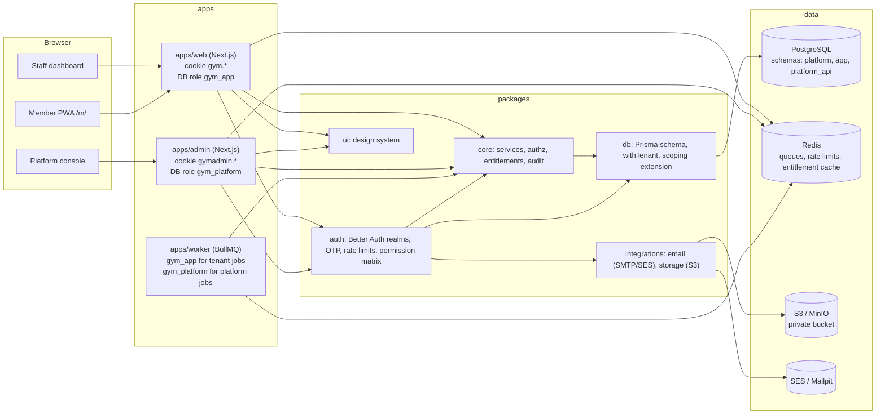

# Architecture

pnpm + Turborepo monorepo. Three deployable apps share a set of packages. Business logic lives in
`packages/core`; apps are thin adapters (server actions, route handlers, jobs).

## Request flow (tenant realm)

1. `proxy.ts` only redirects: no session cookie → `/sign-in`. It is not a security boundary.
2. The page or action calls `getSessionState()` (`apps/web/lib/session.ts`), which resolves, from the
   verified Better Auth session only:
   user → active tenant on the session → **re-verified** membership → roles → grants → MFA status →
   allowed branch. Result: `anonymous`, `no-tenant` (picker or onboarding), `pending-approval`,
   `mfa-required` (`/verify`), or `ready` with an `AuthContext`.
3. Server actions call `getAuthContext()` again (never trusting the page) and pass the context to a core
   service.
4. The core service runs the checks in order: **subscription status → entitlement (402) → permission (403)**
   (`guard()`), then validates input, then runs inside `withTenant()`, where **quotas (402)** are checked
   and usage counters, the change and the audit row commit together.
5. RLS enforces the tenant again in PostgreSQL.

## Two auth realms (D-03)

|                    | Tenant realm (`apps/web`)                                               | Platform realm (`apps/admin`)                         |
| ------------------ | ----------------------------------------------------------------------- | ----------------------------------------------------- |
| Better Auth tables | `app.user`, `app.session`, `app.account`, `app.verification`            | `platform.platform_user`, `platform_session`, …       |
| Secret             | `AUTH_SECRET`                                                           | `ADMIN_AUTH_SECRET` (must differ in production)       |
| Cookie prefix      | `gym.`                                                                  | `gymadmin.`                                           |
| DB role            | `gym_app`                                                               | `gym_platform`                                        |
| Sign-in            | Email + password, Google (when configured)                              | Email + password; no self-signup (CLI creates admins) |
| Second factor      | Email OTP: always for owners/admins, per-tenant setting for other staff | Email OTP, always                                     |
| Rate-limit prefix  | `gym:rl:tenant:*`                                                       | `gym:rl:platform:*`                                   |

The email OTP is our own step on top of Better Auth (`packages/auth/src/otp.ts`), stored as
`mfa_verified_at` on the session, because the requirement depends on the user's role **in the active
tenant** and must also apply after Google sign-in.

## Jobs

`packages/core/src/jobs/catalogue.ts` lists every queue and job payload (Zod). Every job carries
`{ tenantId | null, actor, idempotencyKey }`; the worker re-validates it and gives the handler either
`tenantDb()` (tenant jobs, RLS) or `platform()` (platform jobs, `gym_platform`), never both.

| Queue      | Job                      | Schedule        |
| ---------- | ------------------------ | --------------- |
| `system`   | `system.ping`            | on demand (dev) |
| `platform` | `platform.expire-trials` | every 15 min    |

## Transactional outbox (design; relay lands with its first consumer in M2)

`app.outbox` rows are written **in the same transaction** as the business change (e.g. "invoice issued →
send receipt"). A relay job in the worker claims due rows (`status = PENDING AND available_at <= now()`,
`FOR UPDATE SKIP LOCKED`, through a `SECURITY DEFINER` function because it spans tenants), enqueues a
BullMQ job with `jobId = outbox.id` (so a crash between enqueue and mark-done cannot create two jobs), and
marks the row `DONE`. Failures increment `attempts` and push `available_at` back with exponential backoff;
after the limit the row becomes `FAILED` and shows up in the platform job dashboard. M1 sends its few
transactional emails (OTP, verification, invitations) directly, because they are user-initiated and the
user can retry.

## Entitlements

Feature catalog in `platform.feature` (mirrored by `FEATURES` in `packages/core/src/entitlements`).
Resolution: catalog default ← plan value ← newest unexpired override. Cached in Redis
(`gym:ent:v1:<tenant>`, 5 min, or until the next override expiry); every platform change that affects it
(plan change, override, status change, trial expiry) deletes the key.
