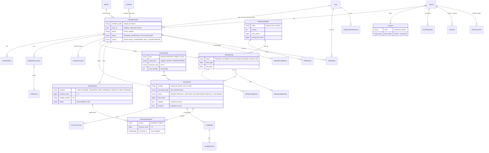
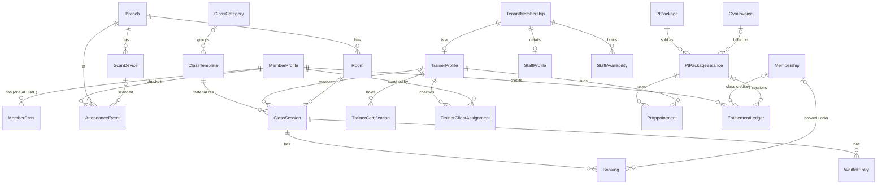
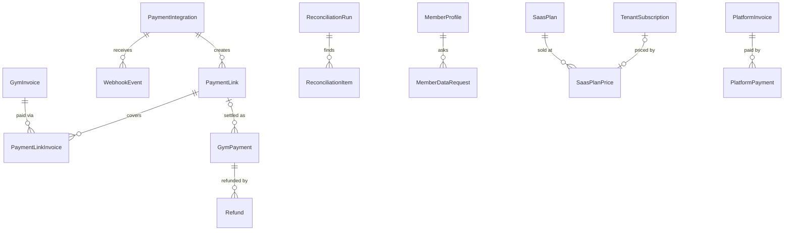
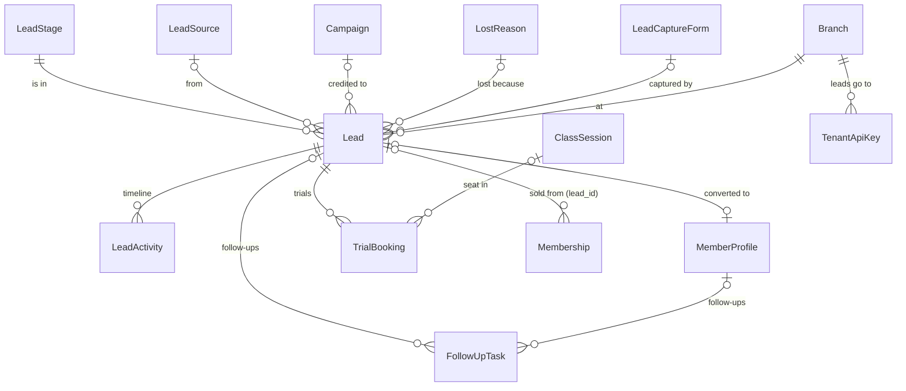

# Database design

PostgreSQL 18, Prisma 7 multi-schema (`packages/db/prisma/schema.prisma`). Started in M1; extend it
with every milestone.

## Schemas and roles

| Schema         | Holds                                                                                    | Who can touch it                                                                                         |
| -------------- | ---------------------------------------------------------------------------------------- | -------------------------------------------------------------------------------------------------------- |
| `platform`     | Operator accounts, tenants, plans, features, subscriptions, usage, platform audit        | `gym_platform` (admin app, worker platform jobs): full. `gym_app`: a narrow, RLS-filtered slice (below). |
| `app`          | Tenant-realm identity (users, sessions) and every tenant-owned table                     | `gym_app` (web, worker tenant jobs), with RLS on tenant-owned tables. `gym_platform`: **no access**.     |
| `platform_api` | `SECURITY DEFINER` functions: the only way the platform realm reaches tenant data (D-05) | `gym_platform` may execute them.                                                                         |

`gym_owner` owns every object and runs migrations and seeds. It is the table owner, so RLS does not
apply to it (tables are not `FORCE ROW LEVEL SECURITY`). Never use it at runtime.

### What `gym_app` may do in `platform`

| Table                                                                                                                            | Rights                                         | RLS for gym_app                                    |
| -------------------------------------------------------------------------------------------------------------------------------- | ---------------------------------------------- | -------------------------------------------------- |
| `feature`, `saas_plan`, `plan_feature`, `platform_setting`                                                                       | SELECT                                         | none (catalog data)                                |
| `tenant`                                                                                                                         | SELECT, INSERT, UPDATE of profile columns only | own tenant, or tenants the current user belongs to |
| `tenant_subscription`                                                                                                            | SELECT, INSERT (self-signup)                   | own tenant                                         |
| `subscription_override`, `support_session`                                                                                       | SELECT                                         | own tenant                                         |
| `usage_counter`                                                                                                                  | SELECT, INSERT, UPDATE                         | own tenant                                         |
| `platform_user`, `platform_session`, `platform_account`, `platform_verification`, `platform_otp_challenge`, `platform_audit_log` | none                                           | —                                                  |

## Tenant isolation (D-05)

1. **Service layer.** Every tenant query runs inside `withTenant(db, tenantId, fn)`. It sets
   `app.tenant_id` with `set_config(..., true)` for that transaction only, and wraps the client in
   `tenantScope(tenantId)`, a Prisma extension that adds `tenantId` to every filter and created row of
   the models listed in `packages/db/src/tenant-models.ts`. A write tagged with another tenant throws.
2. **RLS.** Every tenant-owned table has `tenant_id = app.current_tenant_id()` for `USING` and `WITH CHECK`.
   With no tenant set, `current_tenant_id()` is NULL and nothing matches.
3. **Composite foreign keys** stop cross-tenant links: `role_assignment (tenant_id, membership_id)` →
   `tenant_membership (tenant_id, id)` and `(tenant_id, branch_id)` → `branch (tenant_id, id)`.

`tenant_membership` has one extra read rule: a user may read their **own** memberships across tenants
when `app.user_id` is set (`withUser`), so the tenant picker works. Writes still need the tenant.

Guard rails, all in tests:

- `packages/db/test/registry.test.ts`: every `app` model is either in `TENANT_MODELS` or `GLOBAL_APP_MODELS`,
  and exactly the models with a `tenantId` are tenant models.
- `packages/auth/test/tenancy.int.test.ts`: every tenant table has RLS enabled and a policy; raw SQL from
  tenant A sees, updates and deletes nothing of tenant B; `gym_platform` gets "permission denied" on
  every `app` table; `gym_app` cannot read platform accounts.

### Adding a tenant-owned table (checklist)

1. Model in schema `app` with `tenantId` + relation to `Tenant`, `@@unique([tenantId, id])` if children
   reference it, indexes starting with `tenantId`.
2. Add the model name to `TENANT_MODELS`.
3. In the migration: `ENABLE ROW LEVEL SECURITY` and the `tenant_isolation` policy (copy from
   `20261102092234_m1_rls_grants_functions`).
4. Add a cross-tenant case to the integration tests.

## Functions

| Function                                                       | Caller       | Purpose                                                                                             |
| -------------------------------------------------------------- | ------------ | --------------------------------------------------------------------------------------------------- |
| `app.current_tenant_id()`, `app.current_user_id()`             | RLS policies | Read the transaction-local settings; NULL when unset                                                |
| `app.find_invitation_by_token(hash)`                           | gym_app      | Returns `(id, tenant_id)` for an invite link, before the tenant is known                            |
| `platform_api.create_owner_invitation(...)`                    | gym_platform | Owner invite for a platform-created tenant                                                          |
| `platform_api.record_tenant_audit(...)`                        | gym_platform | Mirrors platform actions (suspension, support access) into the tenant's audit log                   |
| `platform_api.tenant_owner_contacts(tenant)`                   | gym_platform | Owner names and emails only                                                                         |
| `platform_api.support_tenant_snapshot(session, platform_user)` | gym_platform | Settings, branches and counts; refuses unless the support session is open and belongs to the caller |

## M1 entities

```mermaid
erDiagram
  PlatformUser ||--o{ PlatformSession : has
  PlatformUser ||--o{ PlatformAccount : has
  PlatformSession ||--o{ PlatformOtpChallenge : "second factor"
  PlatformUser ||--o{ PlatformAuditLog : wrote
  PlatformUser ||--o{ SupportSession : opened

  Tenant ||--o| TenantSubscription : has
  SaasPlan ||--o{ TenantSubscription : "subscribed to"
  SaasPlan ||--o{ PlanFeature : sets
  Feature ||--o{ PlanFeature : "valued by"
  Feature ||--o{ SubscriptionOverride : "overridden by"
  Tenant ||--o{ SubscriptionOverride : has
  Tenant ||--o{ UsageCounter : counts
  Tenant ||--o{ SupportSession : "accessed by"

  User ||--o{ Session : has
  User ||--o{ Account : "password / Google"
  Session ||--o{ OtpChallenge : "second factor"
  User ||--o{ TrustedDevice : remembers
  User ||--o{ TenantMembership : "belongs to"

  Tenant ||--o{ TenantMembership : has
  TenantMembership ||--o{ RoleAssignment : holds
  Branch ||--o{ RoleAssignment : "scopes (null = all)"
  Tenant ||--o{ Branch : has
  Tenant ||--o{ Invitation : sends
  Tenant ||--o| TenantSettings : has
  Tenant ||--o{ AuditLog : records
  Tenant ||--o{ Outbox : queues
  Tenant ||--o{ IdempotencyRecord : remembers

  Tenant {
    uuid id PK
    string slug UK
    enum status "PENDING_APPROVAL ACTIVE SUSPENDED CANCELLED"
    string timezone
    string currency
  }
  TenantSubscription {
    uuid tenant_id UK
    uuid plan_id FK
    enum status "TRIALING ACTIVE PAST_DUE GRACE SUSPENDED CANCELLED"
    timestamptz trial_ends_at
  }
  SaasPlan {
    string code
    int version
    enum status "DRAFT ACTIVE RETIRED"
  }
  User {
    uuid id PK
    string email UK
    enum status "ACTIVE DEACTIVATED"
  }
  Session {
    uuid active_tenant_id
    uuid active_branch_id
    timestamptz mfa_verified_at
  }
  TenantMembership {
    uuid tenant_id
    uuid user_id
    enum status "ACTIVE DEACTIVATED"
  }
  RoleAssignment {
    uuid tenant_id
    uuid membership_id
    string role_key
    uuid branch_id "nullable"
  }
  Branch {
    uuid tenant_id
    string code "unique per tenant"
    string state_code
    string gstin "nullable"
  }
```

### Notes per table

| Table                                           | Ownership         | Notes                                                                                                                                   |
| ----------------------------------------------- | ----------------- | --------------------------------------------------------------------------------------------------------------------------------------- |
| `tenant`                                        | platform          | Slug unique across tenants. Never deleted; `CANCELLED` instead.                                                                         |
| `tenant_subscription`                           | platform (tenant) | One per tenant. Trial expiry job moves `TRIALING` → `trial.expired_status` (platform setting). Billing fields arrive in M4.             |
| `saas_plan`                                     | platform          | Versioned (`code` + `version`). Only `DRAFT` plans are editable; live plans get a new version.                                          |
| `subscription_override`                         | platform (tenant) | Per-tenant feature value with optional expiry; newest unexpired wins.                                                                   |
| `usage_counter`                                 | platform (tenant) | Updated in the same transaction as the change it counts (`branches.max`, `staff.max`). The admin reads these, not tenant tables.        |
| `user` / `session` / `account` / `verification` | global identity   | Better Auth tables (tenant realm). One `user` per email (D-04). Session also stores active tenant/branch and MFA time.                  |
| `otp_challenge`                                 | global identity   | HMAC of the code, 10-minute expiry, attempt counter, single use.                                                                        |
| `trusted_device`                                | global identity   | SHA-256 of the cookie token; 30 days; only honoured for roles below administrator.                                                      |
| `tenant_membership`                             | tenant            | `(tenant_id, user_id)` unique. Deactivation is per tenant.                                                                              |
| `role_assignment`                               | tenant            | Role key string (custom roles later). `branch_id` null = all branches.                                                                  |
| `invitation`                                    | tenant            | Token stored as SHA-256; 7-day expiry; `roles` JSON validated with Zod.                                                                 |
| `tenant_settings`                               | tenant            | GST identity, tax-inclusive prices, staff 2FA requirement, logo key.                                                                    |
| `audit_log`                                     | tenant            | Append-only for `gym_app` (UPDATE/DELETE revoked). Platform actions arrive via `platform_api.record_tenant_audit`.                      |
| `outbox`                                        | tenant            | Written in the same transaction as the change; the worker relay (M2) claims rows and turns each into a BullMQ job (job id = outbox id). |
| `idempotency_record`                            | tenant            | Created in M1 for M2+ payment and form retries.                                                                                         |

## M2 entities (members, memberships, billing)

All 24 tables are tenant-owned: `tenant_id` + FK, RLS `tenant_isolation`, registered in
`TENANT_MODELS`, and child rows reference parents through composite `(tenant_id, id)` keys so a
row can never point at another gym's record. Money is `BIGINT` paise; calendar dates in the tenant
timezone are Postgres `date` columns (`LocalDate` strings in code).

### Notes per table (M2)

| Table                                                       | Notes                                                                                                                                                                                                                                              |
| ----------------------------------------------------------- | -------------------------------------------------------------------------------------------------------------------------------------------------------------------------------------------------------------------------------------------------- |
| `member_profile`                                            | Record lifecycle only; membership state is derived from `membership`. Duplicate detection on phone/email within the tenant (staff can override). `user_id` set by the app invite or the join link.                                                 |
| `contact_consent`                                           | Append-only (UPDATE/DELETE revoked). The latest row per channel + purpose wins; marketing needs `GRANTED`, service messages are on unless `REVOKED`.                                                                                               |
| `member_note`, `member_document`, `file_record`             | Notes have a visibility level (`members.notes_private`). Documents go to S3 by presigned upload; `file_record` keeps key, type, size and scan status (scan hook is a stub).                                                                        |
| `membership_plan`, `plan_branch`, `coupon`                  | Plans are versioned (`code` + `version`): editing a plan that has sales archives it and creates the next version, so sold memberships keep their terms. Coupons list the plan codes they apply to. Entitlements JSON is validated by a Zod schema. |
| `membership`, `membership_event`, `membership_freeze`       | State machine in `packages/core/memberships/rules.ts`; every transition writes an append-only event and an audit entry. `end_date >= start_date` CHECK.                                                                                            |
| `invoice_series`                                            | One row per (kind, supplier GSTIN or `UNREGISTERED`, financial year). The next number is taken with `INSERT … ON CONFLICT` + `SELECT … FOR UPDATE` inside the issuing transaction, so numbers are gap-free and never reused.                       |
| `gym_invoice`, `gym_invoice_line`                           | Immutable once issued (trigger `gym_invoice_immutable`; only status, PDF and void fields change). Lines are append-only; per-line half-up tax. Never deleted.                                                                                      |
| `credit_note`, `credit_note_line`                           | Append-only. The only way to correct or cancel an issued invoice.                                                                                                                                                                                  |
| `gym_payment`, `payment_allocation`                         | Payments are immutable except void fields (trigger `gym_payment_immutable`), never deleted. Voiding reverses allocations (`reversed_at`) instead of deleting them.                                                                                 |
| `member_credit_entry`                                       | Append-only ledger: overpayments and refunds add, applied credit and manual refunds subtract. Balance = sum.                                                                                                                                       |
| `notification`, `notification_preference`, `email_template` | One row per channel. Email rows are delivered through the outbox (the outbox payload carries the notification id); `dedupe_key` makes reminders idempotent.                                                                                        |
| `data_job`                                                  | CSV import/export jobs; the report or file lives in S3; exports expire after 24 h.                                                                                                                                                                 |
| `tenant_counter`                                            | Per-tenant counters (member codes), row-locked like invoice series.                                                                                                                                                                                |

M2 functions:

| Function                                                | Caller           | Purpose                                                                                              |
| ------------------------------------------------------- | ---------------- | ---------------------------------------------------------------------------------------------------- |
| `app.outbox_claim(limit, lease_seconds, max_attempts)`  | worker (gym_app) | Claims due rows across tenants with `FOR UPDATE SKIP LOCKED` and a lease (SECURITY DEFINER)          |
| `app.outbox_complete(id)`, `app.outbox_fail(id, error)` | worker (gym_app) | Marks a claimed row done, or schedules a retry with backoff; return `void` (call with `$executeRaw`) |
| `app.find_join_tenant(slug)`                            | web (gym_app)    | The join page's gym, only when the tenant is active and has self-signup on                           |

## M3 entities (check-in, classes, staff & trainers, PT)

| Table                                                | Notes                                                                                                                                                                                                                                                                                         |
| ---------------------------------------------------- | --------------------------------------------------------------------------------------------------------------------------------------------------------------------------------------------------------------------------------------------------------------------------------------------- |
| `member_pass`                                        | `pass_id` (22 random base64url chars, no PII, unique across tenants) + `secret_encrypted` (32 random bytes, envelope-encrypted with `DATA_ENCRYPTION_KEY`). Partial unique index: one `ACTIVE` pass per member. Never deleted.                                                                |
| `attendance_event`                                   | Every scan (accepted and refused, with `reject_code`) and manual check-in/out. Partial unique index `(tenant_id, pass_id, time_step) WHERE result='ACCEPTED' AND method='QR'` = each code accepted once. Trigger: only `occurred_at` (re-time) and the void fields may change. Never deleted. |
| `scan_device`                                        | Optional named scanner per branch.                                                                                                                                                                                                                                                            |
| `class_category`, `room`                             | Calendar colour; room capacity and clash checks.                                                                                                                                                                                                                                              |
| `class_template`                                     | Weekly RRULE subset as columns (`by_days`, `start_date`, `until_date` or `occurrence_count`), local `start_minute`, booking window, cancel cutoff, waitlist, eligible plan codes, `version`.                                                                                                  |
| `class_session`                                      | Materialized occurrence; unique `(tenant_id, template_id, occurrence_date)` makes materialization idempotent. Snapshot of the booking rules. `booked_count` changed only by the conditional UPDATE; CHECK `0 <= booked_count <= capacity`. `conflict_note` flags sessions kept as they were.  |
| `booking`                                            | One live booking per member per session (partial unique). `used_credit`, `late_cancel`. Never deleted.                                                                                                                                                                                        |
| `waitlist_entry`                                     | Unique position per session; one `WAITING` entry per member. Statuses WAITING / PROMOTED / LEFT / SKIPPED / EXPIRED.                                                                                                                                                                          |
| `staff_profile`, `trainer_profile`                   | Keyed by `(tenant_id, user_id)` with a FK to `tenant_membership(tenant_id, user_id)`, so they can only exist for people in that gym. Pay fields on `staff_profile`.                                                                                                                           |
| `trainer_certification`                              | Optional private file (`file_record`, purpose `CERTIFICATE`).                                                                                                                                                                                                                                 |
| `staff_availability`                                 | WEEKLY rows (ISO weekday) and EXCEPTION rows (date, available or not), minutes after local midnight. CHECKs keep the shapes valid.                                                                                                                                                            |
| `trainer_client_assignment`                          | History kept; one current row per trainer + member (partial unique).                                                                                                                                                                                                                          |
| `pt_package`, `pt_package_balance`, `pt_appointment` | Catalogue; a sold package keeps its own copy of the terms and links to its invoice; appointments use it.                                                                                                                                                                                      |
| `entitlement_ledger`                                 | Append-only (no UPDATE/DELETE for `gym_app`). Class credits per membership and PT sessions per package; balance = sum. Partial unique indexes make the grant and each booking/appointment movement happen once. CHECK: the source column matches the kind.                                    |

Settings added: `tenant_settings.checkin_duplicate_minutes`, `dues_at_checkin`, `auto_mark_class_attendance`, `booking_reminder_hours`, `late_cancel_forfeits_credit`, `pt_no_show_consumes_session`, `pt_cancel_cutoff_hours`; `branch.checkout_enabled`; `member_profile.photo_file_id`.

## M4 entities (online payments, refunds, SaaS billing, privacy)

Gym side (schema `app`, RLS like every tenant table):

| Table                                       | Notes                                                                                                                                                                                                                                                         |
| ------------------------------------------- | ------------------------------------------------------------------------------------------------------------------------------------------------------------------------------------------------------------------------------------------------------------- |
| `payment_integration`                       | One gym's Razorpay (or, in development, test-provider) account. Key and webhook secrets envelope-encrypted; `secret_last4` only for display. Partial unique index: one `ACTIVE` per gym. Rotating creates a new row (new webhook URL) and closes the old one. |
| `payment_link`                              | Our `reference_id` (unique, ≤ 40 chars), provider id, short URL, amount, partial rules, purpose (INVOICES / BALANCE / RENEWAL / PURCHASE), status merged from provider state. Row-locked while a sync applies.                                                |
| `payment_link_invoice`                      | Which invoices a link pays, in allocation order (`position`).                                                                                                                                                                                                 |
| `webhook_event`                             | Stored once per `(integration_id, event_id)`; payload redacted (no card, VPA, contact, notes). Status RECEIVED / PROCESSED / FAILED / IGNORED, attempts, error.                                                                                               |
| `refund`                                    | `receipt` unique (Razorpay idempotency key); kind ONLINE / MANUAL; PENDING_APPROVAL → PENDING → PROCESSED / FAILED / REJECTED; the credit notes it issued; requester and approver.                                                                            |
| `reconciliation_run`, `reconciliation_item` | QUICK (15 min), DAILY, MANUAL runs with counts; items stay OPEN until staff resolve them with a note.                                                                                                                                                         |
| `member_data_request`                       | EXPORT (recorded when downloaded) and DELETION (OPEN until staff complete or decline).                                                                                                                                                                        |
| `gym_payment` (extended)                    | `provider_payment_id` unique per gym (one payment per Razorpay payment), `payment_link_id`.                                                                                                                                                                   |

Settings added: `tenant_settings.payment_link_expiry_days`, `online_partial_allowed`, `online_min_partial_minor`,
`refund_approval_threshold_minor`, `dues_reminder_days`; `membership_plan.online_purchase`;
`member_profile.privacy_accepted_at`, `privacy_notice_version`, `anonymized_at`. Credit ledger kinds
`ONLINE_REFUND`, `REFUND_REVERSED`.

Platform side (schema `platform`; written only by `gym_platform`):

| Table                                  | Notes                                                                                                                                                                                                     |
| -------------------------------------- | --------------------------------------------------------------------------------------------------------------------------------------------------------------------------------------------------------- |
| `saas_plan_price`                      | Price per plan and cycle (MONTHLY / HALF_YEARLY / YEARLY), GST-inclusive; `provider_plan_id` created lazily at first checkout and cleared when the price changes. `gym_app` may read it.                  |
| `platform_payment_account`             | The operator's Razorpay account (encrypted like the gyms'); one active.                                                                                                                                   |
| `tenant_subscription` (extended)       | Provider subscription id (unique) and status, current period, `cancel_at_period_end`, `past_due_at`, `grace_ends_at`, pending (downgrade) plan/price, last payment.                                       |
| `platform_invoice`, `platform_payment` | SaaS invoice per captured payment (`SAAS/YY-YY/00001`, supplier/recipient snapshots, CGST/SGST/IGST), immutable by trigger; one payment per provider payment id. A gym (`gym_app`) can read only its own. |
| `platform_webhook_event`               | Stored once per event id; replayed by the hourly billing job when stuck or failed.                                                                                                                        |
| `dunning_attempt`                      | One email per stage per period (`dedupe_key` unique).                                                                                                                                                     |
| `announcement`                         | Audience ALL / PLANS / STATUSES, start and optional end, archived. `gym_app` may read it.                                                                                                                 |
| `platform_counter`                     | SaaS invoice numbering per financial year.                                                                                                                                                                |

Functions: `app.webhook_integration(id)` (SECURITY DEFINER; the webhook route finds the integration and
its encrypted secret before it knows the tenant), `platform_api.tenant_billing_identity(tenant)` (legal
name, GSTIN and state for the SaaS invoice recipient).

## M5 entities (CRM)

| Table                                    | Notes                                                                                                                                                                                                                                                                                                                                                                                  |
| ---------------------------------------- | -------------------------------------------------------------------------------------------------------------------------------------------------------------------------------------------------------------------------------------------------------------------------------------------------------------------------------------------------------------------------------------- |
| `lead_stage`                             | Custom name, fixed `category` (NEW … LOST), position. Live names unique (case-insensitive). Never deleted: archived after its leads move to a stage of the same category; the last stage of a category can't go.                                                                                                                                                                       |
| `lead`                                   | Contact (E.164 phone, lower-case email; CHECK at least one), branch, stage, owner, status OPEN/WON/LOST (CHECKs: won/lost dates agree with the status; LOST needs a reason), score, source/campaign, raw UTM, `first_touch`/`last_touch` snapshots (attribution), consent text + time, marketing consent, first/last contact, `sla_breached_at` (once), converted member + membership. |
| `lead_activity`                          | Timeline: note, call (outcome in `meta`), email, meeting, stage change, assignment, task, trial, capture, conversion. **Append-only** (no UPDATE/DELETE for `gym_app`).                                                                                                                                                                                                                |
| `follow_up_task`                         | For a lead, a member, or the branch; kind (FIRST_CONTACT, FOLLOW_UP, CALLBACK, TRIAL, OTHER), due, assignee, status, `reminded_at` (reminder once).                                                                                                                                                                                                                                    |
| `trial_booking`                          | Free slot or a class seat (same conditional `booked_count` UPDATE as member bookings); status BOOKED/ATTENDED/NO_SHOW/CANCELLED; `pass_code` (random, unique, no PII) for the trial pass QR `GT1.<code>`. One live trial per lead per class (partial unique).                                                                                                                          |
| `lead_source`, `lost_reason`, `campaign` | Configurable lists; sources carry score points; campaigns have a unique tracking code (matched to utm_campaign), channel, dates, optional budget.                                                                                                                                                                                                                                      |
| `lead_capture_form`                      | Branch, unguessable public `key` (unique across tenants), fields, consent text, thank-you, default source/campaign, allowed embed sites.                                                                                                                                                                                                                                               |
| `tenant_api_key`                         | Name, public `prefix` (unique across tenants), SHA-256 of the secret, scopes, branch, last used, revoked.                                                                                                                                                                                                                                                                              |
| `lead_saved_view`                        | A user's (or shared) list filters.                                                                                                                                                                                                                                                                                                                                                     |
| `lead_assignment_cursor`                 | Round-robin pointer per branch (row-locked while assigning).                                                                                                                                                                                                                                                                                                                           |
| `event_consumption`                      | `(tenant, event, handler)` receipts: each event handler runs once. Append-only.                                                                                                                                                                                                                                                                                                        |

Also: `membership.lead_id` (the lead a sale converted), CRM settings on `tenant_settings` (`lead_assignment`,
`lead_first_contact_minutes`, `task_reminder_minutes`, with range CHECKs), `DataJobKind` LEAD_IMPORT/LEAD_EXPORT.
Domain events reuse `outbox` (topic `event`, row id = event id).

Functions: `app.capture_form_lookup(slug, key)`, `app.api_key_lookup(prefix)`, `app.trial_pass_lookup(code)`
(SECURITY DEFINER; the public form, the API and the scanner find the tenant before working inside it);
`platform_api.outbox_dead_letters(limit)`, `outbox_stats()`, `outbox_retry(id)` (operator System health:
metadata only, never payloads).

## M6 entities (WhatsApp, campaigns, automation, retention)

All tenant-owned (`tenant_id` + composite FKs `(tenant_id, id)`, RLS, scoping-extension registry, cross-tenant test).

| Table                                                | Purpose / key rules                                                                                                                                                                                                                                                                                 |
| ---------------------------------------------------- | --------------------------------------------------------------------------------------------------------------------------------------------------------------------------------------------------------------------------------------------------------------------------------------------------- |
| `whatsapp_account`                                   | The gym's own WABA + phone number (D-12): ids, display number, quality, messaging limit, **sealed token** (`access_token_enc`, last 4 shown), method MANUAL / EMBEDDED_SIGNUP / FAKE, status. Partial uniques: one non-disconnected account per gym; a phone number id belongs to one gym at a time |
| `message_template`                                   | Synced copies of Meta templates (name, language, category, status, NAMED/POSITIONAL, placeholder list, body, components). Unique per account + name + language; deleted in Meta → status DELETED (kept for history)                                                                                 |
| `suppression_record`                                 | Never message this address on this channel (OPT_OUT, BLOCKED, BOUNCED, MANUAL). Partial unique: one active record per address; lifting sets `lifted_at` (needs recorded consent). No DELETE                                                                                                         |
| `contact_consent` (M2, extended)                     | Now for a member **or** a lead (CHECK exactly one); methods add WEB_FORM, API, INBOUND_KEYWORD                                                                                                                                                                                                      |
| `conversation`, `inbound_message`                    | One thread per number per account; `last_inbound_at` drives the 24-hour window. Inbound rows unique per provider message id, append-only                                                                                                                                                            |
| `outbound_message`                                   | Every WhatsApp send: unique `idempotency_key` (`campaign:<recipient>`, `auto:<execution>:<step>`, `notif:<key>`, …) and provider message id; QUEUED → SENDING → SENT → DELIVERED → READ, or FAILED / SKIPPED with the reason; category, purpose, pricing category                                   |
| `message_event`                                      | Verified webhook items, unique per dedupe key (`status:<wamid>:<status>`, `inbound:<wamid>`, …), processed by the worker                                                                                                                                                                            |
| `segment`                                            | Saved audience: Zod-validated JSON DSL over whitelisted fields (never SQL)                                                                                                                                                                                                                          |
| `campaign` (M5, extended)                            | `segment_id`, `template_id`, `variable_map`, `send_status`, schedule/launch/complete/cancel times, throttle (1–1000/min), attribution days (1–90), estimated recipients                                                                                                                             |
| `campaign_recipient`                                 | Taken from the audience when the campaign starts; unique per campaign + phone; links to its outbound message                                                                                                                                                                                        |
| `automation_workflow`, `automation_workflow_version` | Workflow + immutable versions (definition JSON); `current_version_id`                                                                                                                                                                                                                               |
| `automation_execution`                               | One per (version, trigger key), **unique**; never twice per workflow + key across versions (checked); status, next step, resume time, context                                                                                                                                                       |
| `automation_step_run`                                | Unique per execution + step: the record that a step happened (idempotent retries), approvals (who, when)                                                                                                                                                                                            |
| `retention_rule`                                     | Per gym and kind: enabled + threshold (CHECK > 0)                                                                                                                                                                                                                                                   |
| `retention_flag`                                     | Person + rule + reason + numbers; partial unique: one OPEN/ACTIONED flag per person per rule                                                                                                                                                                                                        |
| `recovery_outcome`                                   | RENEWED / PAID / REACTIVATED / CONVERTED after a flag, campaign or automation; unique per kind + ref id; append-only                                                                                                                                                                                |

Also on `tenant_settings`: `opt_out_keywords` (English + Hindi/transliterations), `opt_in_keywords`,
`marketing_daily_cap` (0–10, default 1), `whatsapp_notification_templates` (notification → template mapping).
Platform setting `whatsapp.embedded_signup_enabled` (default false).

Function: `app.whatsapp_route(phone_number_id, waba_id)` (SECURITY DEFINER; the webhook finds the gym before
working inside it; disconnected accounts never match).

## M7 entities (fitness, nutrition, engagement)

All tenant-owned (`tenant_id` + composite FKs, RLS, scoping-extension registry, cross-tenant test). Health data
tables are readable only through the fitness access rule in core (member / assigned trainer / `fitness.view_all`).

| Table                                                              | Purpose / key rules                                                                                                                           |
| ------------------------------------------------------------------ | --------------------------------------------------------------------------------------------------------------------------------------------- |
| `health_data_consent`                                              | Append-only history (GRANTED / REVOKED, text version, evidence); nothing fitness-related is stored without the latest = GRANTED               |
| `exercise`                                                         | The gym's library: a copy of the built-in 150 exercises (`library_key`, unique per gym) plus custom ones; hidden, never deleted               |
| `workout_template`                                                 | Reusable program; `structure` JSON (weeks → days → items with stable item ids), Zod-validated                                                 |
| `workout_plan` + `workout_plan_version`                            | The member's own copy (assignment: trainer, dates, status; partial unique: one ACTIVE per member); every edit is a new immutable version      |
| `workout_log` + `set_log`                                          | A workout (planned day or free) and its sets (unique per log + exercise + set number; value CHECKs)                                           |
| `personal_record`                                                  | Append-only; kind + value + previous + the set that made it                                                                                   |
| `fitness_assessment`, `member_goal`                                | Measurements/tests (fixed metric schema) and goals (auto-achieved from measurements)                                                          |
| `food_item`                                                        | The gym's food list: copy of the built-in `124 common foods per 100 g with source, plus custom; macro CHECKs                                  |
| `nutrition_plan` + `meal_plan_item`                                | Trainer's diet plan with targets (partial unique: one ACTIVE per member)                                                                      |
| `food_log`, `water_log`                                            | Member entries with estimated macros, source (LIBRARY/CUSTOM/PLAN), assumptions, corrected flag                                               |
| `trainer_feedback`                                                 | Trainer notes on a workout, assessment, nutrition or general                                                                                  |
| `gym_announcement`                                                 | Gym → members news (all / branch / plan); in-app notifications on publish. (`platform.announcement` is operator → gyms)                       |
| `streak_state`                                                     | One per member: current/longest weeks, status ACTIVE/FROZEN/BROKEN                                                                            |
| `achievement` + `member_achievement`                               | Milestone definitions per gym (seeded) and who earned what (unique, append-only)                                                              |
| `challenge` + `challenge_participant`                              | Visits/workouts challenges; participants with display name, board opt-in, progress, completed                                                 |
| `reward_rule`, `reward_ledger`, `reward_perk`, `reward_redemption` | Points per trigger; append-only ledger with unique `source_key` (every award once); perks; redemptions (CREDIT links its member credit entry) |
| `referral_code`, `referral`                                        | One random code per member; referral per lead (unique), status PENDING → REWARDED                                                             |

Also: `tenant_settings` streak/reward settings (with range CHECKs), `CreditEntryKind.REWARD`. Functions:
`app.referral_lookup(slug, code)` (public invite page, SECURITY DEFINER) and `app.erase_member_health_data(member)`
(called by the member-deletion flow; deletes workouts, PRs, plans, assessments, goals, food/water logs, diet plans
and trainer feedback in the current tenant).

## M8 entities (intelligence)

| Table                  | Purpose / key rules                                                                                                                                                                                                                                                                                                                                                                                                                                                                              |
| ---------------------- | ------------------------------------------------------------------------------------------------------------------------------------------------------------------------------------------------------------------------------------------------------------------------------------------------------------------------------------------------------------------------------------------------------------------------------------------------------------------------------------------------ |
| `app.metric_daily`     | **Derived data**, tenant-owned (RLS, registry). Key (tenant, branch, local day): active/paused snapshot, new members, check-ins, unique visits, invoiced (net of credit notes), payments, refunds, `reconstructed` flag. Written only by the nightly `metrics.rollup` job and `pnpm metrics:rebuild` (every source filtered by tenant explicitly as well as by RLS). Safe to delete and rebuild, except nightly snapshots of active/paused for past days (rebuilt days are marked reconstructed) |
| `app.ai_request_log`   | One row per Copilot question: user, outcome (ANSWERED / FALLBACK / FLAGGED / ERROR), mode, model, tool names with timings, token counts, latency, number of ungrounded figures. **No question, answer or tool data.** RLS; no UPDATE for the app; deleted after the provider's `log_retention_days` by the nightly job. The monthly Copilot quota counts these rows                                                                                                                              |
| `platform.ai_provider` | One row (`id = 'default'`): label, base URL, model, **sealed** API key + last-4 hint, timeout, max tokens, enabled, `supports_tools` (from "Test connection"), last test result, log retention, per-gym rate. The gym runtime role has a **column-level** SELECT grant without the admin-only test notes; only servers with `DATA_ENCRYPTION_KEY` can open the key                                                                                                                               |

Also: `tenant_settings.kpi_grace_days` (default 7, 0–90); `data_job.progress` (0–100) and `DataJobKind.REPORT_EXPORT`;
indexes `refund(tenant_id, processed_at)`, `credit_note(tenant_id, issue_date)`, `trial_booking(tenant_id, attended_at)`;
function `platform_api.ai_usage(since)` (operator console: requests and tokens per gym, no content).

## Migrations

| Migration                                      | What                                                                                                                                                                 |
| ---------------------------------------------- | -------------------------------------------------------------------------------------------------------------------------------------------------------------------- |
| `20261102053753_init`                          | M0 placeholder `health_check`                                                                                                                                        |
| `20261102054049_db_roles_and_rls_helpers`      | Schema `app`, role grants, `app.current_tenant_id()`                                                                                                                 |
| `20261102091355_m1_saas_core`                  | All M1 tables (generated)                                                                                                                                            |
| `20261102092214_m1_plan_trial_days_to_setting` | Drops `saas_plan.trial_days` (trial length is a platform setting)                                                                                                    |
| `20261102092234_m1_rls_grants_functions`       | RLS, grants, `platform_api` functions, default features/plans/settings                                                                                               |
| `20261104074333_m2_members_billing`            | All M2 tables and the new tenant settings (generated)                                                                                                                |
| `20261104074408_m2_rls_and_guards`             | M2 RLS, append-only grants, immutability triggers, CHECKs, outbox and join functions                                                                                 |
| `20261104075414_m2_invitation_member`          | `invitation.member_id` for member app invites                                                                                                                        |
| `20261104184129_m3_floor_operations`           | All M3 tables, settings and the member photo column (generated)                                                                                                      |
| `20261104184500_m3_rls_and_guards`             | M3 RLS, one-time-QR and other partial unique indexes, CHECKs (no overbooking), append-only grants, attendance trigger                                                |
| `20261105090000_m4_payments_saas_billing`      | All M4 tables, enums and new columns (generated with `prisma migrate diff`)                                                                                          |
| `20261105090100_m4_rls_and_guards`             | M4 RLS, one active integration per gym, CHECKs, no DELETE, `webhook_integration()`, SaaS invoice immutability, grants, starting prices                               |
| `20261105090200_m4_platform_api`               | `platform_api.tenant_billing_identity()`                                                                                                                             |
| `20261105120000_m5_crm`                        | All M5 tables, enums, `membership.lead_id`, CRM settings (generated with `prisma migrate diff`)                                                                      |
| `20261105120100_m5_rls_and_functions`          | M5 RLS, append-only timeline/receipts, no DELETE, CHECKs, partial uniques, public lookups, outbox dead-letter functions                                              |
| `20261105180000_m6_growth_automation`          | All M6 tables and enums, campaign/consent/settings columns (generated); only non-additive change: `contact_consent.member_id` nullable                               |
| `20261105180100_m6_rls_and_functions`          | M6 RLS (16 tables), partial uniques, CHECKs, append-only grants, no DELETE, `app.whatsapp_route()`                                                                   |
| `20261106090000_m7_fitness_engagement`         | All M7 tables, enums and settings columns (generated; additive only)                                                                                                 |
| `20261106090100_m7_rls_and_guards`             | M7 RLS (28 tables), one active plan per member, value CHECKs, append-only grants, `app.referral_lookup()`                                                            |
| `20261106090200_m7_reward_credit_kind`         | `CreditEntryKind` gains `REWARD`                                                                                                                                     |
| `20261106090300_m7_erase_health_data`          | `app.erase_member_health_data()` for member deletion                                                                                                                 |
| `20261106120000_m8_intelligence`               | M8 tables (`metric_daily`, `ai_request_log`, `platform.ai_provider`), `kpi_grace_days`, `data_job.progress`, `REPORT_EXPORT`, KPI indexes (generated; additive only) |
| `20261106120100_m8_rls_and_grants`             | M8 RLS, no UPDATE on the AI log, value CHECKs, column-level grant on `ai_provider`, `platform_api.ai_usage()`                                                        |

Never edit an applied migration or run `prisma migrate reset` on a database that may hold real data.
